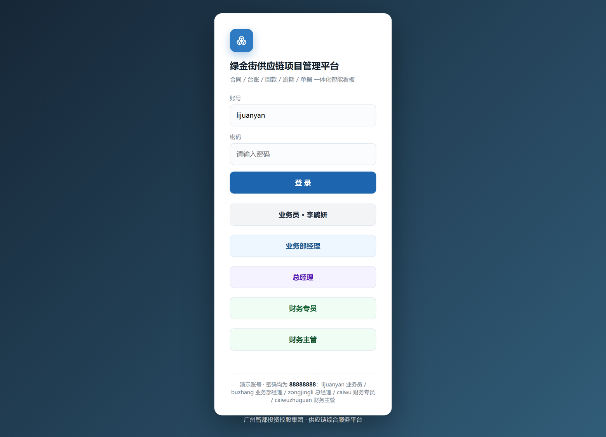
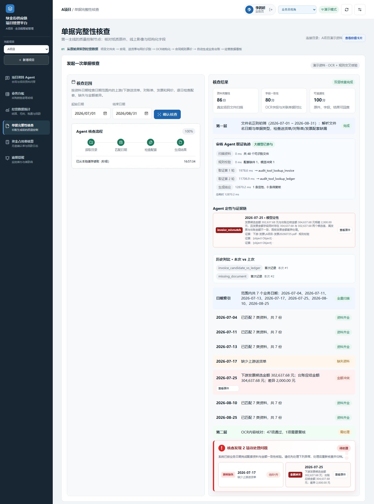
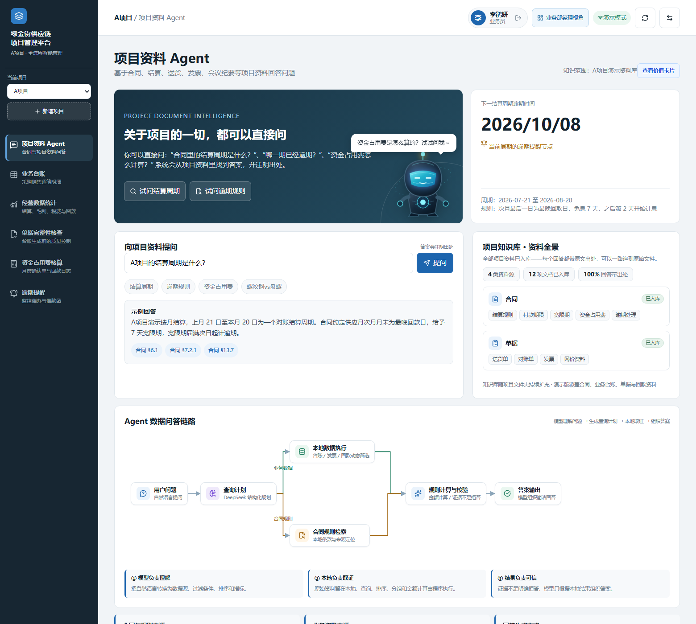
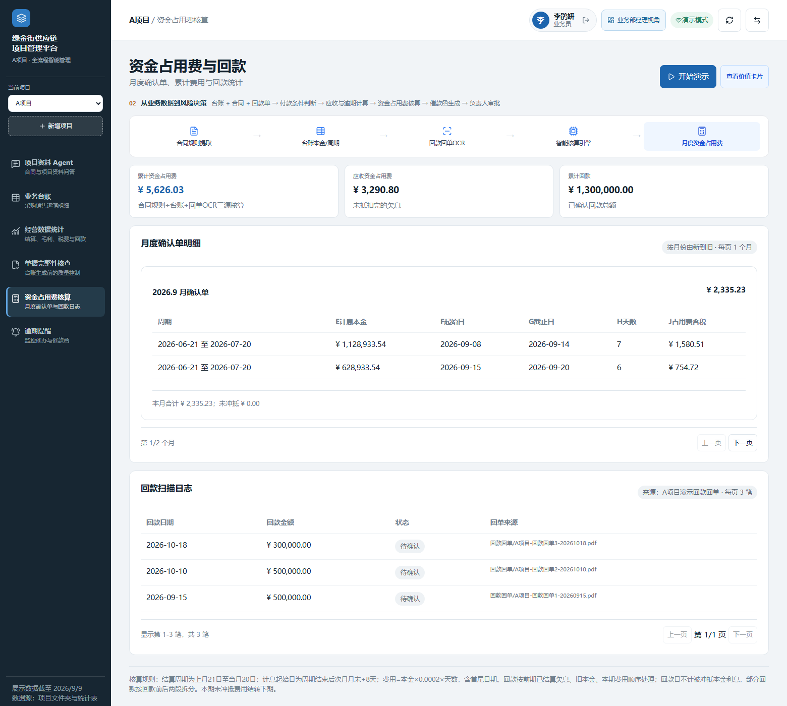
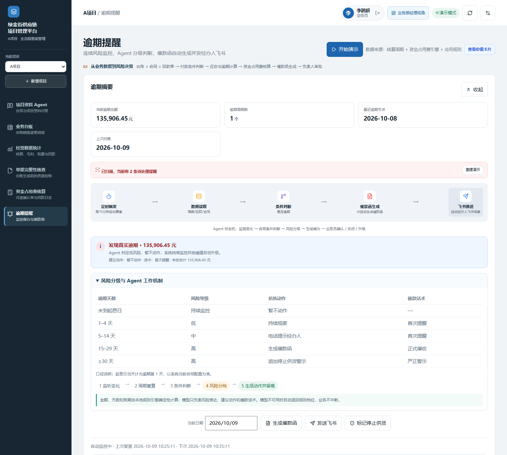
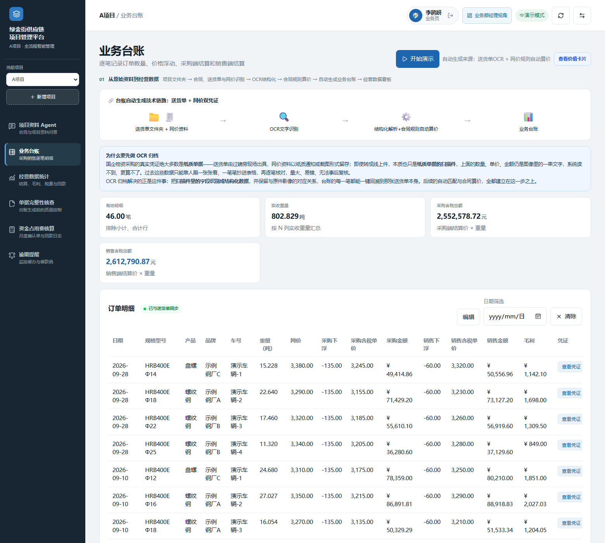
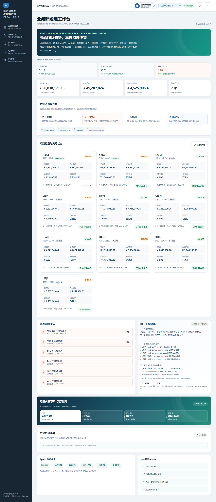
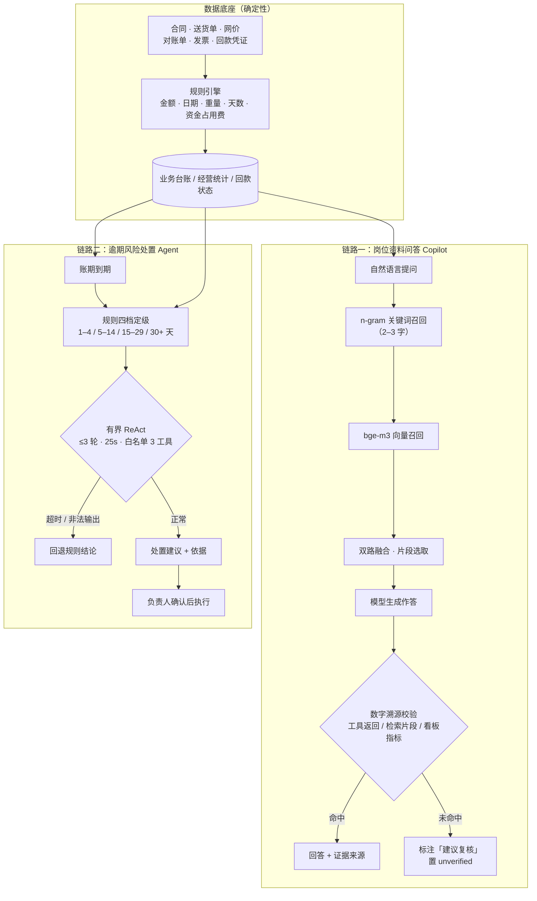

# 绿金街供应链项目管理平台 · 供应链 AI 控制塔

<p align="center">
  
  
  
  
  
  
</p>

**面向钢材供应链业务的本地控制塔**：把合同、送货单、网价、对账单、发票和回款凭证串成一条**可核查、可计算、可追溯**的业务链路，覆盖单据完整性核查、业务台账、经营统计、资金占用费核算、逾期提醒、项目资料问答六大模块，服务业务员、业务部经理、财务专员、财务主管、总经理五类岗位。

独立设计并开发 · 飞书 AI 先锋大赛铜奖 · 核心功能可离线运行

<p align="center">
  
  <br/>
  <sub>登录页：五类岗位角色一键进入，权限边界从登录开始生效</sub>
</p>

---

## 界面速览

<table>
<tr>
<td width="50%"><br/><sub><b>单据完整性核查</b>：资料配套、日期金额一致性、可追溯性，逐项列出冲突与缺失</sub></td>
<td width="50%"><br/><sub><b>项目资料问答</b>：检索取证后作答，每条结论可回看来源片段</sub></td>
</tr>
<tr>
<td><br/><sub><b>资金占用费核算</b>：分段计息 + 回款冲抵，计算步骤可逐步展开复核</sub></td>
<td><br/><sub><b>逾期提醒</b>：按账期四档定级，生成催办建议或催款函，保留负责人确认</sub></td>
</tr>
<tr>
<td><br/><sub><b>业务台账</b>：由送货单与网价按合同规则生成采购、销售、税额、毛利明细</sub></td>
<td><br/><sub><b>经理工作台</b>：按角色汇总待办、风险与经营口径，不做全量信息平铺</sub></td>
</tr>
</table>

> 另有 11 张界面与原始凭证对照图见 [`docs/作品图文说明书/assets/`](./docs/作品图文说明书/assets/)，两段实操录屏见 [`docs/assets/videos/`](./docs/assets/videos/)。

---

## 30 秒读懂

| 问题 | 答案 |
| --- | --- |
| **是什么** | 一个跑在本机/内网的供应链业务控制塔：从单据核查到台账、资金占用费、逾期风控，一条链走完 |
| **给谁用** | 钢材贸易类业务与财务岗；五角色分工，谁能看什么、谁能确认什么由权限决定 |
| **AI 在哪里** | 两条链路：**岗位资料问答 Copilot**（检索取证后作答）与**逾期风险处置 Agent**（有界 ReAct 多轮选工具） |
| **AI 不做什么** | 金额、天数、费用等关键数字全部由规则引擎计算，**不进入模型上下文**；审批与确认永远由人签字 |
| **怎么保证不胡说** | 生成后对回答里每个数字做溯源比对，未命中即标注「建议复核」并置 unverified |
| **怎么验证** | 35 条固定用例覆盖路由、证据引用、数字锚定、越界拒答，作为每次迭代的回归基线 |
| **能不能离线** | 能。模型缺失时自动降级：云端模型 → 本机模型 → 规则/纯关键词检索 |

---

## 为什么这样设计

供应链业务里最贵的成本，往往不是算错一个数字，而是**资料分散在多个环节、口径各自成立**——同一个业务事实，在业务、财务、管理三条线上有三个说法。等发现对不上时，凭证已归档，责任已经模糊。

这套平台把这件事收敛成一条链：**资料先核查，台账再计算，经营、回款和风险从同一数据底座派生，最后回到对应岗位确认和处置。**

| 管理要求 | 系统里的落点 |
| --- | --- |
| **授权可界定** | 五个角色各自能看什么、能确认什么由权限决定；模型不越权，也不代替任何岗位签字 |
| **过程可复核** | 台账、经营统计、资金占用费由确定性规则计算，每一步可展开看计算依据；凭证可回看原件 |
| **责任可闭环** | 逾期提醒、催款函、回款登记都保留负责人确认环节；系统给建议，人做决定 |
| **推广可复制** | 本地或内网运行，数据不出企业；先在一个项目验证规则口径，再按同一套规则复制到其他项目 |

> AI 在这里是提效工具，不是决策主体。这是有意为之的取舍，不是能力妥协。

---

## 系统架构



**设计约束在图上是可以看出来的：**

- 数值从 `RULE` 出来，**不流进模型上下文**——模型只读文本证据，不碰算术；
- 两条链路都有**失败兜底出口**（`A2` 标注复核 / `D3` 回退规则），没有「硬编一个看起来对的答案」这条路；
- 处置建议必须经过 `D5` 人工确认，Agent 不自动执行。

---

## 三条关键设计

### 1. 幻觉控制：计算与生成解耦 + 生成后校验

金额、天数、费用由规则引擎计算，**数值不进入模型上下文**；生成后对回答中每一个数字做溯源比对（工具返回 / 检索片段 / 看板指标），未命中即标注「建议复核」并置 `unverified`。

不是靠提示词说「不要编造数字」，而是靠**结构上不给它编的机会 + 事后逐个数字对账**。

### 2. 有界 ReAct 工具调用 + Human-in-the-loop

逾期风险由规则按 **1–4 / 5–14 / 15–29 / 30+ 天**四档定级，模型只在档位内多轮选择工具：**≤3 轮、25s 预算、白名单限 3 个工具**。超时或输出非法即回退规则结论；处置建议保留负责人确认。

作用是把「Agent 自由发挥」压成「Agent 在有限空间内选动作」——**可控性来自预算和边界，不来自模型的自觉**。

### 3. 混合检索与评测基线

2–3 字 n-gram 关键词 + bge-m3 向量双路召回，本机模型缺失时自动降级为纯关键词检索，保证任何环境下都能给出可追溯的答案。

以 **35 条固定用例**覆盖路由、证据引用、数字锚定、越界拒答，作为每次改动后的回归基线——改提示词、换模型、调检索之前先跑一遍，退化了立刻知道。数字锚定基线与**数据集版本**绑定（当前 v3：回款回单 20260915 / 20261010 / 20261018，累计资金占用费 6,468.65 元）；替换 `A项目-演示资料` 后需按新资料重新核算锚点并同步 `agent_harness.py`，否则数字锚定用例会如预期报 FAIL——这是基线在「报警」，不是误报。

---

## 功能模块

| 模块 | 做什么 |
| --- | --- |
| **单据完整性核查** | 检查资料配套、日期/金额一致性、可追溯性，列出冲突、缺失和待确认项，可打开来源凭证 |
| **业务台账** | 读取送货单与网价，按合同规则生成采购、销售、税额和毛利明细 |
| **经营数据统计** | 按所选周期汇总销售、采购、毛利、回款和风险指标 |
| **资金占用费核算** | 按合同规则分段计息、处理回款冲抵，输出可复核的计算步骤 |
| **逾期提醒** | 按账期计算风险，生成催办建议或催款函，保留负责人确认环节 |
| **项目资料问答** | 对合同与项目资料检索取证，回答附带可查看的来源 |

---

## 技术栈

| 层 | 选型 | 说明 |
| --- | --- | --- |
| 后端 | **Python 标准库**（`http.server` / `sqlite3` / `threading`） | 零 Web 框架依赖，一个 `server.py` 启动；断网可跑 |
| 前端 | **单文件 HTML + 原生 JS**（ECharts / Lucide 本地内置） | 无构建步骤，双击即用 |
| 文档解析 | pymupdf · pypdf · openpyxl · python-docx | 合同、对账单、台账、催款函 |
| OCR | rapidocr_onnxruntime（模型随包内置，**本地推理**） | 回款回单、扫描件，不出网 |
| 检索 | n-gram 关键词 + bge-m3 向量双路召回 | 模型缺失自动降级纯关键词 |
| Agent | 有界 ReAct（轮次 / 超时 / 工具白名单）+ 规则回退 | 失败不降级为「看起来像答案」 |
| 存储 | SQLite（`runtime/<dataset>/`）+ 文件型数据 | 数据留在本地 |
| 评测 | `agent_harness.py`（35 条用例，HTTP 契约级） | 离线可跑，作为回归基线 |

---

## 快速开始

**环境要求：Python 3.10 ~ 3.14**（已实测 3.10 / 3.11 / 3.12）。

```bash
git clone https://github.com/505260971-dotcom/lvjinjie-supply-chain-platform.git
cd lvjinjie-supply-chain-platform

# 1) 安装依赖（仅可选增强能力，缺了也能跑）
python -m pip install -r requirements.txt

# 2) 启动
python server.py
```

浏览器打开 **http://127.0.0.1:8787**

| 项 | 值 |
| --- | --- |
| 演示账号 | `lijuanyan` / `buzhang` / `caiwu` / `caiwuzhuguan` / `zongjingli` |
| 统一密码 | `88888888`（可用 `DEMO_PWD_*` 环境变量覆盖） |
| 端口 | `server.py` 默认 **8787**；启动脚本会注入 `PORT=8927`，故现场文档写的是 8927，两者等价，可用 `PORT=xxxx python server.py` 指定 |
| 启用云端问答 | 配置相应 API Key；未配置时自动走本地规则/检索链路 |

> 依赖全部为**可选增强**：未安装 `pymupdf` / `rapidocr_onnxruntime` 时，对应格式的解析会降级，不阻塞主线演示。OCR 与业务计算均在本机运行；若启用云端模型，问答内容会发送给相应服务商处理，仓库内资料均为合成演示数据。

---

## 目录结构

```text
.
├─ server.py                    # 后端主体（路由 / 规则引擎 / Agent / 台账计算）
├─ index.html                   # 单文件前端（五角色工作台与各业务模块）
├─ agent_harness.py             # 35 条用例的回归基线（契约级 HTTP 评测）
├─ requirements.txt             # 可选增强依赖
├─ static/                      # 前端静态资源（ECharts / Lucide / 逾期演示）
├─ A项目-演示资料/               # A 项目合成凭证：送货单 / 网价 / 对账单 / 发票 / 回款回单
├─ 新增项目C-演示资料/           # 现场导入演示用资料
├─ docs/
│  ├─ 作品图文说明书/assets/     # 17 张界面与原始凭证对照图
│  ├─ assets/videos/            # 两段实操录屏（含封面图）
│  ├─ assets/vouchers/          # 凭证缩略图
│  └─ index.html                # 静态体验版入口
├─ releases/                    # 打包交付件
├─ 评委请先读我.md               # 演示口径与注意事项
└─ 路演现场速查卡.md             # 现场演示路径速查
```

---

## 核心接口

| 接口 | 用途 |
| --- | --- |
| `POST /api/login` | 登录并下发角色会话 |
| `GET /api/projects` | 项目列表与当前数据集 |
| `GET /api/dashboard` · `GET /api/cycles` | 看板指标 / 结算周期 |
| `GET /api/documents` · `POST /api/audit-ocr` | 资料清单 / 单据核查与 OCR |
| `GET /api/ledger` | 业务台账明细 |
| `GET /api/fee-calc` · `POST /api/repayments` | 资金占用费核算 / 回款登记与冲抵 |
| `POST /api/ask` · `POST /api/chat` | 项目资料问答（含流式） |
| `GET /api/agents` | Agent 与工具注册信息 |
| `POST /api/refresh` · `POST /api/reindex` | 数据刷新 / 检索索引重建 |
| `GET /api/watch` · `GET /api/health` | 文件变更订阅 / 健康检查 |

---

## 评测与验收

服务启动后，在仓库根目录执行：

```bash
# 全量 35 条用例（当前基线：35/35 全过）
python agent_harness.py http://127.0.0.1:8787 --timeout 120

# 只跑单据核查类
python agent_harness.py http://127.0.0.1:8787 --category audit --timeout 300
```

校验的是 **Agent 可观察契约**，而不是「回答像不像」：

- **答案语义**：必须出现的关键结论；
- **证据引用**：回答是否带可回看的来源；
- **工具选择**：是否选中了正确的工具（路由正确性）；
- **数字锚定**：回答中的数字是否与规则引擎计算值逐项一致；
- **越界拒答**：超出授权范围的问题是否被正确拒绝。

---

## 数据说明

- 默认预置 10 个项目：A、B、D、E、F、G、H、J、K、L；C 项目留作现场新增导入演示，导入后共 11 个。
- **A 项目是主演示链路**：资料文件变化可触发台账、经营统计、资金占用费和逾期结果更新。交付包内凭证为脱敏重制的**合成演示件**，不是真实客户、交易或票据。
- 系统配置 5 个演示账号/角色，不代表 5 名实际用户；使用规模以现场操作留痕为准。
- 虚拟组合指标与价值测算仅用于演示，不代表真实经营业绩或已实现收益。

---

## 更多文档

- [评委请先读我](./评委请先读我.md) — 演示口径与限制说明
- [路演现场速查卡](./路演现场速查卡.md) — 现场演示最短路径
- [docs/](./docs/) — 图文说明书、录屏与凭证素材
- [releases/](./releases/) — 打包交付件
